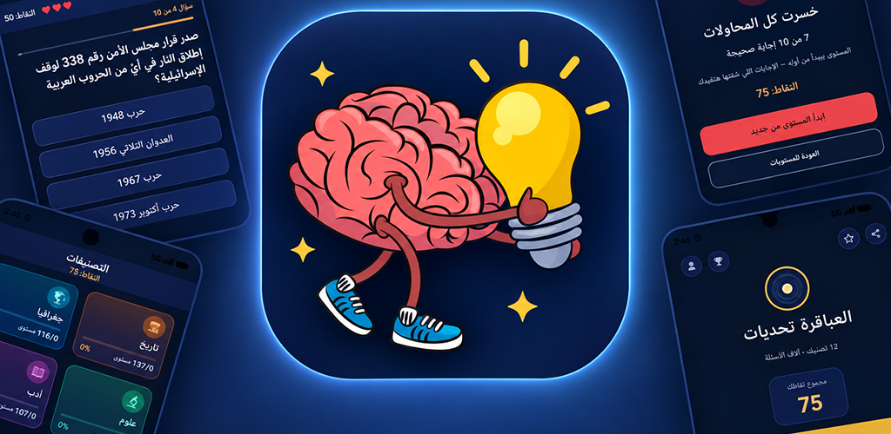

# Abakera (العباقرة): Arabic trivia game

**Type:** MK Studio product: an Android game with its own API and admin dashboard
**Get it:** [Google Play](https://play.google.com/store/apps/details?id=com.mkstudio.abakera) · [abakera.mk-studioeg.com](https://abakera.mk-studioeg.com)
**Year:** 2026
**Stack:** Kotlin · Jetpack Compose · Material 3 · Retrofit · Next.js 15 · Prisma · PostgreSQL · OpenAI · Google Play Games · AdMob · Coolify

## The problem

Most trivia apps ship their whole question bank, answers included, inside the APK. That makes cheating trivial and lets anyone scrape the content. We wanted an Arabic trivia game with thousands of questions where scores are trustworthy and the questions can't be lifted.

## What we built

**Android app.** Native Kotlin with Jetpack Compose. The flow is categories → levels → quiz. A level is 10 questions with 3 lives, plus rewarded continues, reminders, Play Games sign-in, and ads through AdMob.

**Server-authoritative gameplay** in a Next.js API:
- The client never receives the answer key. `GET /question` returns only the text and the options. The correct index comes back from `POST /answer`, and only after the player commits to an option.
- `/answer` takes no question ID: it grades whatever question the server-side run is on, so a client can't skip ahead or answer a question twice.
- Lives, position, and score all live on the server in a `LevelSession`.
- Public bulk endpoints are locked: `/api/questions` returns 401 and `/random` returns 410.

**Safe account linking.** A device token maps to a `PlayerDevice`, and several devices can map to one `Player`. Play Games linking exchanges a **server auth code** with Google instead of trusting a player ID sent by the client, which closes an account-takeover hole.

**Self-calibrating difficulty.** About 7,700 questions are first rated 1 to 5 by an LLM (OpenAI), then re-rated from real play data once a question has 20+ first attempts. Measured data always overrides the estimate.

**Admin dashboard:**
- In-place question editing with search, filters, and keyboard shortcuts.
- Per-player progress.
- Analytics: hardest and easiest questions, the levels where players drop off, and predicted vs. actual difficulty.
- Detection of **"the stored answer is probably wrong"**, flagged when most players pick the same wrong option.

**Clean analytics.** The app detects Firebase Test Lab devices from Google's pre-launch report and tags their requests, so the bots that test every release don't pollute stats, difficulty, or leaderboards.

## Result

- Live on Google Play and updated regularly (v1.0.12).
- Scores can't be cheated from the client, and the question bank can't be scraped.
- The content improves itself: play data fixes difficulty ratings and flags questions with wrong answers.

---

Built and owned by [MK Studio](https://mk-studioeg.com) · [Karim ElGarhy](https://github.com/KarimElGarhy)
