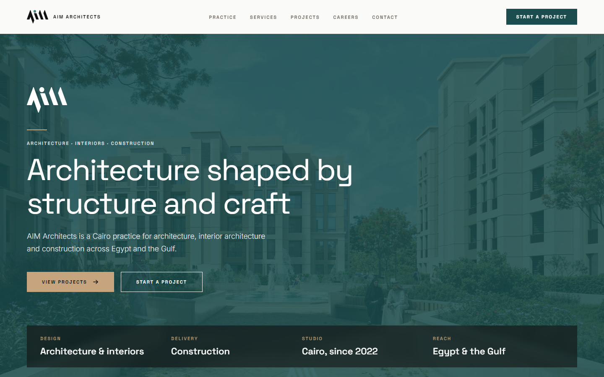

# AIM Architects: edge-native portfolio on Cloudflare Workers

**Client:** AIM Architects, a Cairo practice for architecture, interior architecture, and construction, working across Egypt and the Gulf
**Live:** [aimarchitects-eg.com](https://aimarchitects-eg.com)
**Year:** 2026 (a rebuild of the WordPress site we delivered in 2023)
**Stack:** Next.js 16 · React 19 · TypeScript · Tailwind CSS 4 · Cloudflare Workers (OpenNext) · D1 + Drizzle ORM · R2 · Cloudflare Images · Cloudflare Access · Turnstile · Zod

## The problem

The practice's main sales tool is its portfolio: 77 projects, each with heavy, high-resolution renders. On WordPress that meant slow pages, a bloated plugin stack, and an admin far bigger than they needed. All they really manage is **projects, job openings, and incoming leads**. They also wanted a quieter, monograph-style design to match their brand.

## What we built

**The whole site runs at the edge.** Next.js 16 is deployed to Cloudflare Workers through OpenNext. There's no origin server to patch or scale.
- Content is in **D1** (SQLite), queried with Drizzle ORM through a service layer.
- Media is in **R2**, split into a public bucket and a private one for CVs and backups.

**An image pipeline built for architecture renders.**
- An offline import script used `sharp` to bring the full legacy archive into R2 as 2560 px masters.
- A custom `next/image` loader serves them through Cloudflare Images. A 410 KB JPEG becomes a **33 KB AVIF** at 640 px.

**A small custom admin instead of a full CMS.** Editors manage Projects (with image galleries and draft previews), Jobs, Job Applications (with private CV download), Contact Inquiries, and Site Settings. Nothing more.

**Two layers of admin security.**
- Cloudflare Access with email OTP guards `/admin`, `/api/admin`, and `/preview` at the edge.
- Every admin route also checks the Access JWT itself (issuer, audience, expiry) with `jose`. Even if the edge rule were misconfigured, the admin stays closed.

**Spam-proof forms.** Contact and careers forms use Turnstile, a honeypot, Workers rate limiting, and shared Zod validation. Notifications go out by SMTP with DKIM.

**Search rankings kept through the migration.**
- A generated map 301-redirects every old WordPress URL.
- Renamed project slugs keep working through a `slug_redirects` table.
- Sitemap and robots files are generated from the database.

**Light by design.** No animation library and no UI kit. The motion uses CSS transitions, an IntersectionObserver reveal, and the browser's native `<dialog>`, all on a token-based Tailwind v4 design system with contrast-checked colours.

**Operations.**
- A scheduled Worker purges data past its retention period.
- A weekly GitHub Actions job exports D1 to R2 as a backup.
- Every deploy is logged against its Worker version ID.

## Result

- All 77 projects were imported, published, and served as small, edge-cached AVIF images.
- The client runs a tiny admin with no plugins, no PHP, and nothing to update.
- Hosting is pay-per-use on Cloudflare, and old WordPress URLs redirect to their new pages.

---

Code is private and owned by the client. Built by [Karim ElGarhy](https://github.com/KarimElGarhy) · [MK Studio](https://mk-studioeg.com)
