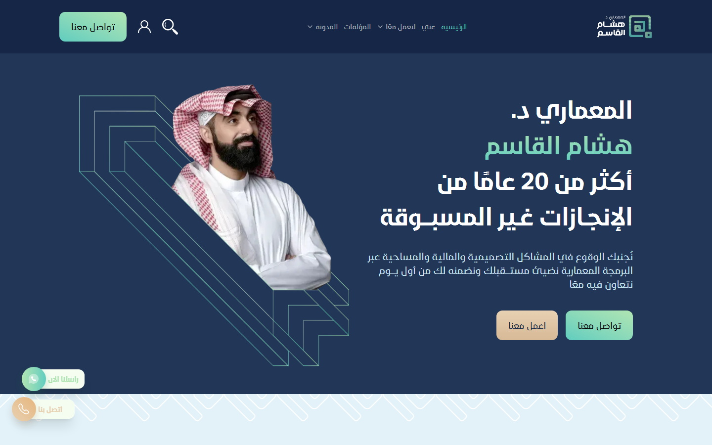

# Dr. Hesham Al-Qassem: Arabic content & events platform

**Client:** Dr. Hesham Al-Qassem, an architect and author with 20+ years in architectural programming
**Live:** [hqassim.com](https://hqassim.com)
**Year:** 2024–2026 (still developing it)
**Stack:** Next.js 16 · React 19 · TypeScript · Tailwind CSS 4 · Strapi 5 · WordPress (headless) · TanStack Query · NextAuth · Docker

## The problem

The client needed more than a profile site. He runs events and workshops, publishes books, and writes a blog in three formats: written, audio, and visual. All of it had to live in one fast Arabic (RTL) site that he could manage himself, and that visitors could sign up to and interact with.

## What we built

- **Two backends, one frontend.** Strapi 5 manages events, services, pages, testimonials, and user activity. The existing WordPress blog runs headless as the content source for articles. Next.js combines both into one site.
- **Events with booking.** Event pages show live availability. Signed-in users can book, rate, comment, and save favorites.
- **User accounts and a dashboard.** Registration and login with NextAuth, plus a personal dashboard for each user's bookings and activity.
- **Blog in three formats.** Written, audio, and visual posts, each with its own listing, pagination, and category views.
- **A caching layer that cut backend load.**
  - Server: an in-memory cache with TTL presets (1 min to 24 h) wrapped around API routes, with `X-Cache: HIT/MISS` headers for debugging and invalidation by key or pattern.
  - Client: TanStack Query hooks for every content type, with prefetching.
  - Next.js 16 `use cache` for page-level caching.
- **Arabic-first SEO.** A sitemap proxy across both backends, `robots.ts`, `llms.txt`, and documented SEO guidelines.
- **Forms with reCAPTCHA** for contact, sponsorship, and workshop requests, sent by email through Nodemailer.
- **An embedded X timeline** that shows his latest posts without needing API keys.

## Result

- One platform for the client's events, books, and three blog formats, all managed from a CMS.
- Visitors now have accounts, bookings, and favorites, so the site builds an audience instead of only showing a profile.
- Caching keeps the site fast even though it pulls from two backends.

---

Code is private and owned by the client. Built by [Karim ElGarhy](https://github.com/KarimElGarhy) · [MK Studio](https://mk-studioeg.com)
