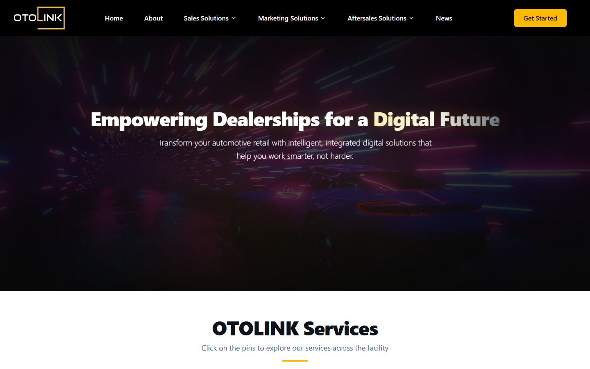

# Otolink: CMS-driven site for an automotive SaaS

**Client:** Otolink, a platform for car dealerships covering sales, marketing, aftersales, and parts. It operates from Dubai and India and serves dealerships in 12+ countries.
**Live:** [otolink.com](https://www.otolink.com)
**Year:** 2026
**Stack:** Next.js 16 · React 19 · TypeScript · Tailwind CSS 4 · Framer Motion · Strapi 5 · PostgreSQL · next-intl · Resend · reCAPTCHA

## The problem

Otolink sells eight products, from showroom reception and digital sales to service booking, telephony, a mobile app, and B2B parts e-commerce. Their customers include dealer groups behind brands like BMW and MINI. They needed a premium, animated corporate site that explains a complex product line clearly, and the marketing team had to be able to build and change pages without a developer.

## What we built

- **A page builder with no hardcoded pages.** Every page is a Strapi Dynamic Zone. Editors build pages from **20+ ready-made blocks**: Hero, Product Accordion, Feature Grid, Interactive Map, Workflow, Impact Stats, Testimonials, Video, Latest News, Client Logo Marquee, CTA, Contact Form, and more. Next.js renders each block from the CMS data.
- **An interactive facility map.** Visitors click pins on an illustration of a dealership to see which Otolink product serves each area: reception, showroom, service bay, and parts.
- **Motion design.** Framer Motion for scroll reveals, animated stat counters, a continuous logo marquee, and product accordions with a separate tablet layout.
- **Editable navigation.** The header menus and footer are managed in Strapi, including the dropdowns for the Sales, Marketing, and Aftersales product groups.
- **Lead capture.** Contact forms are validated with Zod, protected by reCAPTCHA, saved as **Leads** in Strapi, and emailed through Resend.
- **Ready for more languages.** next-intl routing with localized slugs and titles, so adding Arabic or another language is a content task, not a rebuild.
- **News.** Articles managed in the CMS, with the latest posts shown on the homepage.

## Result

- Marketing launches and updates pages from Strapi by putting blocks together, with no developer in the loop.
- One fast, animated site that explains eight products to dealer groups across 12+ countries.

---

Code is private and owned by the client. Built by [Karim ElGarhy](https://github.com/KarimElGarhy) · [MK Studio](https://mk-studioeg.com)
