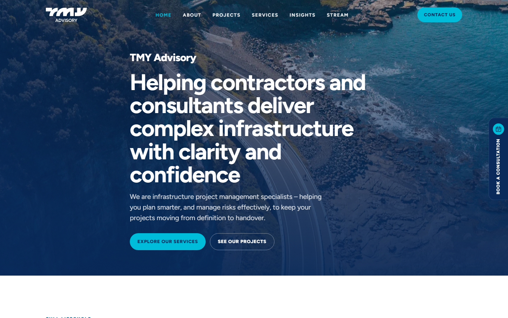

# TMY Advisory: WordPress → Next.js + Payload CMS

**Client:** TMY Advisory, an infrastructure project management firm in Australia that supports rail and transport projects such as Sydney Metro
**Live:** [tmyadvisory.com](https://tmyadvisory.com)
**Year:** 2026 (rebuild of a site we first delivered in 2023)
**Stack:** Next.js 16 · Payload CMS 3 · PostgreSQL 16 · TypeScript · Docker · Coolify

## The problem

We first built the site in WordPress and Elementor. It worked, but every page update meant fighting the page builder, the site was getting slower, and the team wanted a CMS made for their content: projects, insights, and testimonials.

The site already ranked in Google, so the move could not break any existing URLs.

## What we built

- **A headless CMS made for their content.** Payload collections for Posts, Projects, Clients, Testimonials, Members, Categories, and Contact Submissions. Pages are built from blocks (Hero, Rich Text, Image, CTA), so editors arrange content without touching a page builder.
- **A one-command WordPress migration.** An import script reads the WordPress XML export and brings over media, categories, posts, projects, and pages. It is safe to run again because it skips anything already imported.
- **SEO kept through the cutover.** Every old URL was mapped before launch. Posts stay at the root path just as they were in WordPress, and the old routes redirect (`/insights` → `/blog`, `/contact` → `/book-a-consultation`).
- **Contact flow.** Form submissions are saved in the CMS and also emailed over SMTP.
- **Self-hosted deployment.** A Dockerfile and Coolify on a VPS, with a managed Postgres and a persistent volume for media. No vendor lock-in and no per-seat CMS pricing.
- **Tests.** Vitest for unit tests and Playwright for end-to-end flows.

## Result

- A faster site on Next.js, and editors who update content in a clean admin instead of Elementor.
- All legacy content and URLs carried over, with no SEO reset.
- The client owns the full stack and hosts it on their own server.

---

Code is private and owned by the client. Built by [Karim ElGarhy](https://github.com/KarimElGarhy) · [MK Studio](https://mk-studioeg.com)
